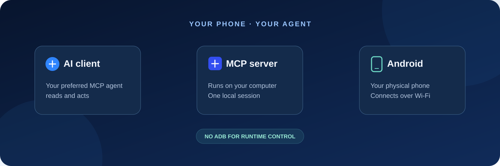

<div align="center">



# Android Phone MCP

**Connect your own Android phone to an AI agent over Wi-Fi — no ADB for runtime control.**

An experimental, self-hosted Android app and MCP server for developers, built by [DroidDesk](https://droiddesk.io/).

[Quick start](#quick-start) · [Tools](#available-tools) · [Security](docs/SECURITY.md) · [DroidDesk AI automation](https://droiddesk.io/ai-phone-automation) · [DroidDesk API & MCP](https://droiddesk.io/docs/api)

</div>

> **Early prototype — use a dedicated test device on a trusted network.** The server exposes powerful screen-reading and control capabilities. This is not security audited or production ready. Do not use it with banking, passwords, personal messages, or other sensitive data.

## What it does

1. Build and install the Android app yourself.
2. Enable its accessibility service and explicitly start a session on the phone.
3. Run the MCP server locally and connect your MCP client.
4. Ask your agent to inspect a screen, tap, type, swipe, open an app, or open a URL.

The app connects **outbound** to your server over HTTPS; the phone does not need a listening port. The server uses a temporary token and the app checks the server certificate fingerprint. The AI model runs in your chosen AI client, not in this project. An internet connection may still be required by your AI provider.

This project can be run independently of DroidDesk rentals and does not require a DroidDesk account, root, USB debugging, or ADB for runtime control. Installation and initial setup in our first real-device test used ADB; a completely ADB-free install and setup flow has not yet been verified. The current prototype app is labelled **DroidDesk Connect** on Android.

## Your phone or a DroidDesk phone

This repository is for developers who want to build the app and control their own Android phone on a local network. If you prefer to rent a remote physical Android phone, [DroidDesk](https://droiddesk.io/) offers a separate service with its own hosted MCP connection. The two use different setup and access credentials; this local prototype does not automatically connect to or manage DroidDesk rentals.

| | Android Phone MCP — this repository | DroidDesk — hosted service |
| --- | --- | --- |
| Device | Your own Android phone | A physical Android phone rented through DroidDesk |
| Setup | Build the app and run the MCP server yourself | Use your DroidDesk account and connect its hosted MCP server |
| Learn more | Continue with the quick start below | [AI phone automation](https://droiddesk.io/ai-phone-automation) · [API & MCP documentation](https://droiddesk.io/docs/api) |

## Status

- Tested on one physical Android phone on 23 November 2026. Screen inspection, JPEG screenshot, tapping, text input, swipe, Home/Back, opening an app and opening a web page worked over Wi-Fi.
- The USB cable remained connected during this test; operation with the cable physically disconnected is **not yet verified**.
- ADB was used only for installation and initial setup; the MCP actions themselves used Wi-Fi.
- Device-specific Android restrictions, power management, protected windows, different Android versions, and long-running sessions need more testing. Claimed minimum Android 8 (API 26) has not been tested; screenshots require Android 11 (API 30) or later.
- No file transfer, iOS, remote relay, multi-user access control, or recording is implemented.

## Quick start

### 1. Build the Android app

Requirements: JDK, Android SDK Platform `android-36.1`, Android Build Tools `36.1.0`, Node.js 20+, npm and OpenSSL. The supplied build script has been tested on macOS with Android Studio; other environments may need adjustments.

```sh
./app/build.sh
cd server
npm ci
cd ..
```

The result is `app/build/connect-debug.apk`, signed with a locally generated **debug** key. Install it manually on your own test phone. Do not publish this debug APK or the generated key. You may use your own preferred installation procedure; ADB is not used by runtime device control.

### 2. Configure an MCP client

The server uses stdio for MCP and an HTTPS endpoint for the phone. Use absolute paths to `node` and `server/index.cjs`. For example, merge this entry into a Codex configuration:

```toml
[mcp_servers.phone_mcp]
command = "/absolute/path/to/node"
args = ["/absolute/path/to/droiddesk-phone-mcp/server/index.cjs"]
env = { DD_SESSION_FILE = "/tmp/phone-mcp-session.json" }
```

Restart the MCP connection or start a new client session. The file in `DD_SESSION_FILE` must **not exist** when the server starts. It is created with owner-only permissions and contains the session token and certificate fingerprint. A crash may leave it behind: remove a stale file after confirming that the old session is no longer running. Do not share or commit it. If you omit this variable, the values are printed to the server's stderr; avoid sharing client logs.

For other MCP clients, configure the same command, arguments, and environment variable using their local/stdio server settings. Runtime pairing does not use an HTTP MCP endpoint.

### 3. Pair the phone

1. Connect your phone and computer to the same **trusted** network. Determine the computer's LAN IP address.
2. Open the Android app, select **Enable accessibility service**, and enable the app's service in Android settings. Android may require additional manual approval for a sideloaded app.
3. Enter `https://<computer-LAN-IP>:8765` in the app. Enter `token` and `certificate_sha256` from the session file. Verify the fingerprint from your own server directly; do not send these values in chat.
4. Tap **Start session** and allow notifications when prompted. On the first request you may have to tap Start again after granting permission.
5. In your MCP client, call `phone_status` and then `get_screen`.

The Android app must be allowed to run, and the phone must reach the computer's chosen interface. The server defaults to port `8765` on all network interfaces. `DD_PORT` changes the port; `DD_BIND` restricts the bind address. **Do not expose it to the internet** or rely on an untrusted Wi-Fi network. Use a firewall as appropriate.

Choose **Stop session** in the Android app when finished. Stop the MCP server too; its temporary certificate and token change on restart. A new session requires entering new pairing values.

## Available tools

| Tool | Purpose |
| --- | --- |
| `phone_status` | Check recent phone polling; may lag disconnection by up to 10 seconds |
| `get_screen` | Read current accessibility elements and bounds |
| `screenshot` | Capture a JPEG image on supported Android 11+ devices |
| `tap`, `swipe` | Interact using screen pixel coordinates |
| `type_text` | Replace text in the focused non-password field |
| `press_home`, `press_back` | Use Android navigation actions |
| `open_app` | Open an installed, visible application by package name |
| `open_url` | Open an HTTP or HTTPS URL |

Some apps provide incomplete accessibility information or block screen capture. Actions can fail or produce an unknown result after a disconnect. **Inspect the phone before repeating an action.** There is currently no snapshot freshness guard, multi-device isolation, operation history, or granular permission model.

## Test locally

```sh
cd server
npm ci
npm test
```

The automated integration test uses a local TLS test client. It is not an Android emulator and does not replace testing on a physical phone. See [architecture and limitations](docs/ARCHITECTURE.md), [security](docs/SECURITY.md) and [contributing](CONTRIBUTING.md).

## License

MIT — see [LICENSE](LICENSE). This project is not an official Google, Android, OpenAI, or Anthropic product.
